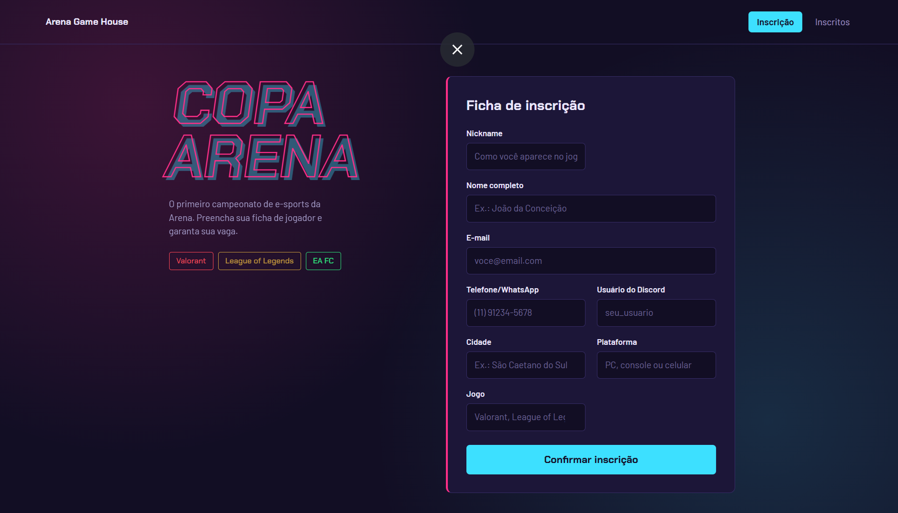
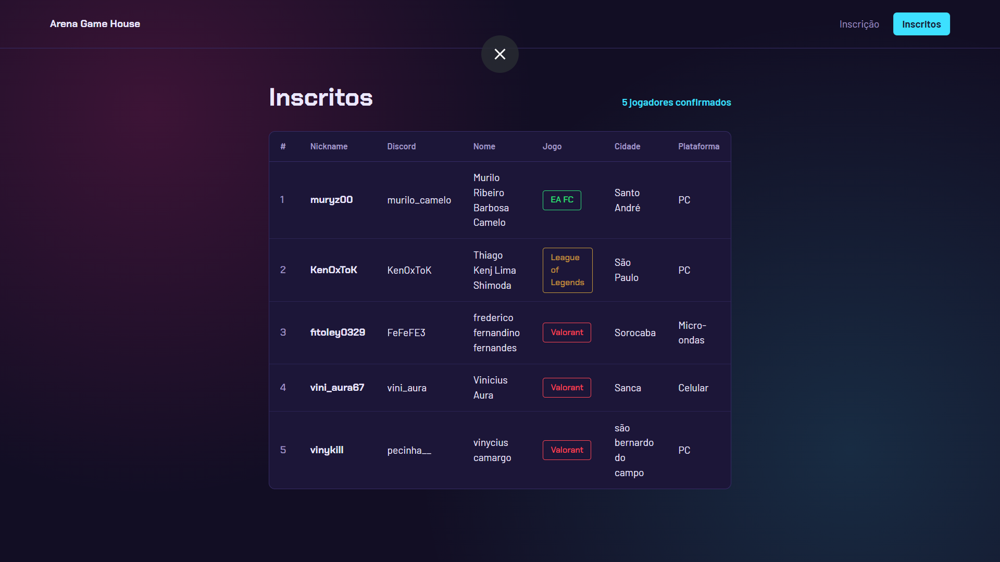

# 🎮 Copa Arena — Sistema de Inscrições

Sistema web de inscrição para a **Copa Arena**, o primeiro campeonato de e-sports da **Arena Game House**, com partidas de **Valorant**, **League of Legends** e **EA FC**.

O jogador faz a própria inscrição em uma página, sem deixar nenhuma informação de fora. O organizador acompanha todos os inscritos em uma segunda página.

> Projeto desenvolvido para o **Desafio Prático: A Copa Arena** do SENAI.



---

## ✨ Funcionalidades

- **Formulário de inscrição** com nickname, nome completo, e-mail, telefone/WhatsApp, usuário do Discord, cidade, plataforma e jogo.
- **Validação no servidor (PHP):** nenhum campo pode ficar vazio. Um campo preenchido só com espaços também conta como vazio.
- **Mensagem de aviso** que lista os campos que faltam. Os campos com erro ficam destacados e **o que o jogador já digitou continua preenchido**.
- **Mensagem de sucesso** quando a inscrição é salva no banco. O formulário volta vazio.
- **Proteção contra inscrição duplicada** ao recarregar a página (padrão Post/Redirect/Get).
- **Suporte a acentos** em todos os campos (banco, conexão e páginas em UTF-8 / `utf8mb4`).
- **Lista de inscritos** com um jogador por linha. Cada jogo aparece com uma cor própria.
- **Segurança:** consultas com *prepared statements* (contra SQL Injection) e saída escapada com `htmlspecialchars` (contra XSS).
- **Extras em JavaScript:** máscara de telefone, foco automático no primeiro campo com erro e mensagem de sucesso que some sozinha.
- **Layout responsivo**, que funciona no computador e no celular.

---

## 🛠️ Tecnologias

| Camada         | Tecnologia                |
| -------------- | ------------------------- |
| Front-end      | HTML5, CSS3, JavaScript   |
| Back-end       | PHP 8 (mysqli)            |
| Banco de dados | MySQL / MariaDB           |
| Ambiente       | XAMPP (Apache + MySQL)    |

---

## 📁 Estrutura do projeto

```
copa_arena/
├── banco.sql       # Script que cria o banco copa_arena e a tabela jogadores
├── conexao.php     # Conexão com o MySQL (UTF-8)
├── index.php       # Página de inscrição: formulário, validação e cadastro
├── lista.php       # Página com a lista de jogadores inscritos
├── style.css       # Estilos das duas páginas
├── main.js         # Máscara de telefone e melhorias de usabilidade
└── prints/         # Capturas de tela usadas neste README
```

---

## 🗄️ Banco de dados

Banco **`copa_arena`** com a tabela **`jogadores`**:

| Coluna          | Tipo         | Descrição                                   |
| --------------- | ------------ | ------------------------------------------- |
| `id`            | INT          | Chave primária, gerada automaticamente      |
| `nickname`      | VARCHAR(50)  | Nome do jogador no jogo                     |
| `nome_completo` | VARCHAR(120) | Nome completo                               |
| `email`         | VARCHAR(120) | E-mail                                      |
| `telefone`      | VARCHAR(20)  | Telefone/WhatsApp                           |
| `discord`       | VARCHAR(50)  | Usuário do Discord                          |
| `cidade`        | VARCHAR(80)  | Cidade                                      |
| `plataforma`    | VARCHAR(20)  | PC, console ou celular                      |
| `jogo`          | VARCHAR(30)  | Valorant, League of Legends ou EA FC        |

---

## 🚀 Como rodar o projeto

**Pré-requisito:** ter o [XAMPP](https://www.apachefriends.org/) instalado.

1. **Clone o repositório** dentro da pasta `htdocs` do XAMPP:

   ```bash
   cd C:\xampp\htdocs
   git clone <url-deste-repositorio> copa_arena
   ```

   Se preferir, baixe o ZIP e extraia em `C:\xampp\htdocs\copa_arena`.

2. **Inicie o Apache e o MySQL** pelo painel de controle do XAMPP.

3. **Crie o banco de dados:**
   - Acesse [http://localhost/phpmyadmin](http://localhost/phpmyadmin).
   - Abra a aba **SQL**.
   - Cole o conteúdo do arquivo `banco.sql` e clique em **Executar**.

4. **Abra o sistema** no navegador:

   ```
   http://localhost/copa_arena
   ```

> A conexão usa o padrão do XAMPP (usuário `root`, sem senha). Se o seu MySQL tiver outra configuração, altere os dados em `conexao.php`.

---

## ✅ Regras do sistema

| Situação                      | O que acontece                                                                 |
| ----------------------------- | ------------------------------------------------------------------------------ |
| Algum campo vazio             | Aparece uma mensagem de aviso e os campos continuam com o que já foi digitado |
| E-mail em formato inválido    | Aparece um aviso pedindo para conferir o e-mail                               |
| Tudo preenchido corretamente  | A inscrição é salva, aparece a mensagem de sucesso e o formulário fica vazio  |
| Nome com acento (ex.: João)   | É salvo e exibido corretamente                                                |

---

## 📸 Capturas de tela

### Página de inscrição


### Lista de inscritos



---

## 👤 Autor

Desenvolvido por **Murilo**, aluno do curso Técnico em Desenvolvimento de Sistemas do **SENAI Roberto Simonsen**.
